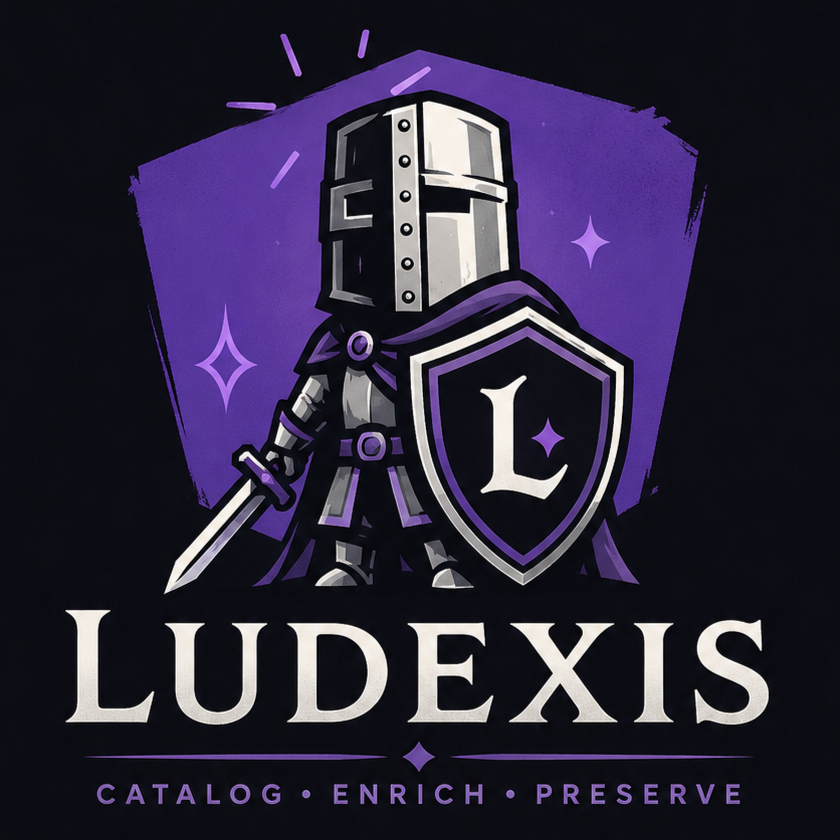
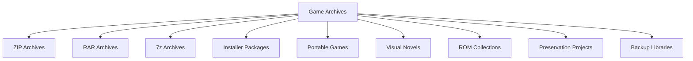
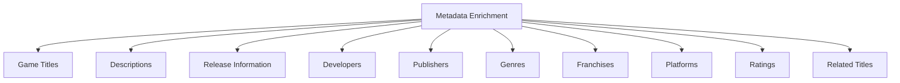
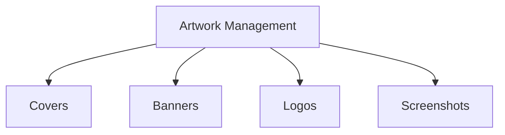
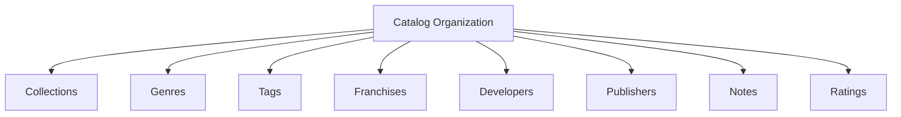
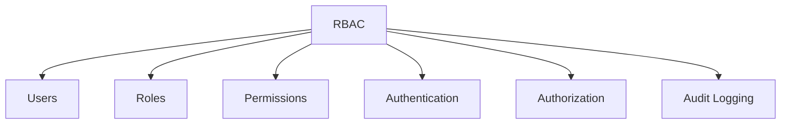
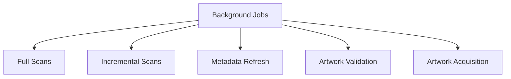
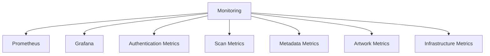
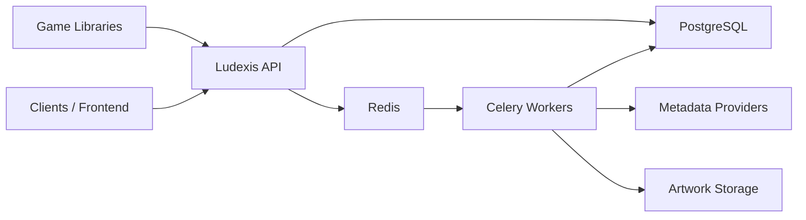
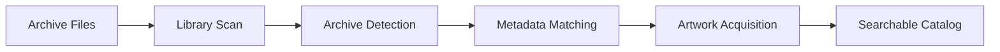

<p align="center">
  
</p>

<!--
<p align="center" style="font-size: 40px;""><strong>Ludexis</strong></p>
-->

<p align="center">
  <strong>Self-Hosted Game Archive & Metadata Management Platform</strong>
</p>

<p align="center">
  <a href="#quick-start">Quick Start</a> •
  <a href="#features">Features</a> •
  <a href="#developer-setup">Developer Setup</a> •
  <a href="#documentation">Documentation</a>
</p>

<p align="center">
  Ludexis is a self-hosted platform for cataloging and preserving game archives. Unlike traditional game launchers, Ludexis focuses on metadata management, artwork acquisition, organization, and long-term archival workflows for collections consisting of ZIP archives, installer packages, visual novels, ROM collections, and preservation projects.
</p>

<p align="center">
  
  
  
  
  
  
  
</p>

---

## Why Ludexis?

Ludexis began as a response to a problem that many digital preservation enthusiasts, visual novel collectors, retro gaming archivists, and self-hosting users eventually encounter: there are plenty of game launchers, but very few tools designed specifically for managing large game archives.

Most existing platforms focus on launching installed games. Their catalogs are typically built around executable discovery, launcher integration, storefront synchronization, or installation management. This works well for modern Steam libraries but becomes increasingly limiting when dealing with preservation-oriented collections.

Many archives consist of compressed releases, installer packages, visual novels, portable games, ROM collections, abandonware archives, backup media, and other content that may never be installed or directly executable. In these scenarios, the archive itself is often the asset being managed rather than a runnable game installation.

Ludexis approaches the problem from a different perspective. Instead of asking "How do I launch this game?", it asks "How do I catalog, organize, enrich, preserve, and manage this archive?"

A single Ludexis deployment can catalog content such as:



Rather than depending on launchers, executables, storefront APIs, or installed applications, Ludexis focuses on metadata management, artwork acquisition, catalog organization, archive preservation, and long-term collection maintenance.

The result is a platform designed specifically for users who maintain game archives rather than game installations.

---

## Overview

Ludexis is a self-hosted game archive management platform designed for users who maintain collections of installers, archived game releases, visual novels, preservation projects, backups, and multi-drive game libraries.

As collections grow across hard drives, NAS systems, external storage devices, and backup archives, maintaining accurate records becomes increasingly difficult. Information such as release versions, publishers, developers, storage locations, screenshots, artwork, and related titles often becomes fragmented or lost entirely.

Ludexis solves this problem by transforming raw archive files into a searchable and enriched catalog. Through automated scanning, metadata matching, artwork acquisition, collections, tagging, and background processing, Ludexis provides a centralized platform for managing and preserving game archives.

Unlike traditional game launchers, Ludexis focuses on cataloging, organization, metadata enrichment, and long-term archival management rather than game launching.

---

## Key Features

### Automated Library Discovery & Scanning

Ludexis continuously catalogs game archives stored across local drives, external storage devices, NAS systems, and archival repositories. Libraries can be configured as scan targets, allowing the platform to automatically discover supported archives and game folders without requiring manual entry.

Both full and incremental scanning modes are supported. Full scans rebuild catalog information across an entire library, while incremental scans process only newly added or modified content, significantly reducing maintenance overhead for large collections.

Discovered entries are normalized and stored in a structured catalog, enabling consistent metadata enrichment and organization regardless of the original archive source.

### Metadata Aggregation & Enrichment

Ludexis automatically enriches archive entries from VNDB, IGDB and Steam through a provider-agnostic architecture that allows additional metadata sources to be integrated over time. A match on one source is completed with whatever the others know about the same game, and any entry can be identified by hand from a search across all of them.

Metadata enrichment transforms raw archive files into richly cataloged entries by retrieving official game information and associating it with discovered archives.



This allows raw archive files to be transformed into rich, searchable catalog entries without extensive manual curation.

### Artwork Acquisition & Management

Ludexis supports comprehensive artwork management for archive entries. Artwork assets are stored locally to ensure long-term availability independent of third-party services.



Artwork may be uploaded manually or automatically acquired through the metadata enrichment pipeline. Validation and maintenance operations ensure artwork remains synchronized with associated archive entries while avoiding duplicate assets and broken references.

### Advanced Catalog Organization

Beyond simple file storage, Ludexis provides multiple organizational layers for managing large collections.



These relationships allow users to build curated collections and navigate large archives through meaningful metadata rather than filesystem structure alone.

### Archive Preservation & Verification

Ludexis is designed with preservation-oriented workflows in mind. Archive records maintain filesystem metadata, verification status, storage information, and catalog history to support long-term archival management.

Planned integrity workflows include archive verification, corruption detection, duplicate identification, and preservation auditing to assist users maintaining large game collections over extended periods.

### User Management & Role-Based Access Control

The platform includes a complete authentication and authorization system built around Role-Based Access Control (RBAC).



This enables Ludexis to scale from single-user deployments to shared archival environments.

### Background Processing & Job Management

Long-running operations execute asynchronously through Celery workers, ensuring the API remains responsive regardless of collection size.



A centralized job system provides visibility into task progress, execution history, completion status, and failure reporting.

### Monitoring & Observability

Ludexis includes built-in operational monitoring through Prometheus and Grafana.



Prometheus, Grafana and Node Exporter ship as an optional profile of the Compose stack, so monitoring costs nothing until it is switched on.

---

## Architecture Overview

Ludexis follows a service-oriented architecture designed around clear separation of responsibilities, asynchronous processing, and persistent metadata storage.



The FastAPI backend serves as the central orchestration layer, coordinating authentication, catalog management, metadata operations, search functionality, and administrative workflows. PostgreSQL stores all persistent data, Redis provides task queue infrastructure, and Celery workers execute long-running background operations independently from user-facing requests.

---

## How Ludexis Works

The processing pipeline transforms raw archive files into fully cataloged archive entries.



When a library scan is initiated, Ludexis discovers archive files and folders, extracts filesystem metadata, creates catalog entries, enriches them using metadata providers, downloads available artwork, and stores the resulting information in a searchable database.

This workflow allows large collections to be cataloged with minimal manual effort while still supporting manual curation when required.

## Quick Start

Ludexis runs as one Docker Compose stack: the web app, API, background worker, scheduler, PostgreSQL, Redis and a small proxy that serves everything on a single port.

### Requirements

- Docker Engine 24+ with Docker Compose
- 2 GB RAM (4 GB recommended for large libraries)
- A folder of games: unpacked game folders and/or archives (`.zip`, `.rar`, `.7z`, `.iso`, `.exe`)

### Install

```bash
curl -O https://raw.githubusercontent.com/InvictusRex/Ludexis/main/docker-compose.yml
curl -O https://raw.githubusercontent.com/InvictusRex/Ludexis/main/.env.example
mkdir deploy && curl -o deploy/Caddyfile https://raw.githubusercontent.com/InvictusRex/Ludexis/main/deploy/Caddyfile
cp .env.example .env
```

Edit `.env`:

```env
GAMES_PATH=/mnt/games    # the folder holding your games, mounted read-only at /games
TZ=Europe/Berlin         # scheduled tasks run in this time zone
POSTGRES_PASSWORD=change-me
```

Or clone the repository and run the same commands from its root; `docker compose up -d --build` builds the images from source.

### Start

```bash
docker compose up -d
```

Open `http://<host>:8420` and sign in with the default account:

| Username | Password |
| -------- | -------- |
| `admin`  | `admin`  |

Ludexis then asks for a new password (and optionally a different username and email) before anything else is available, adds `/games` as the first library, optionally stores IGDB credentials and starts the first scan. Until the password is changed the API refuses every other request for that account. To start with different credentials, set `DEFAULT_ADMIN_USERNAME` and `DEFAULT_ADMIN_PASSWORD` in `.env` before the first start. Locked out later? `docker compose exec backend python -m scripts.reset_password <username>` puts the default password back and asks for a new one at the next sign-in.

The JWT signing secret is generated on first start and kept in the `ludexis_data` volume; set `JWT_SECRET_KEY` only if you want to manage it yourself.

### Metadata sources

| Source | Key needed | Good for |
| ------ | ---------- | -------- |
| VNDB   | No         | Visual novels and Ren'Py games |
| IGDB   | Twitch client ID and secret ([dev.twitch.tv](https://dev.twitch.tv/console)) | Most commercial games |
| Steam  | No         | Steam releases, descriptions and screenshots |

Order and enable them under **Admin > Settings**. The first source with a confident match supplies the metadata, and the other enabled sources fill what it lacks (genres, franchises, artwork) when they clearly have the same game. Developer and publisher names are merged across spellings, so "SEGA" and "Sega" are one company.

When a match is missing or wrong, open the game and choose **Identify**: search VNDB, IGDB or Steam (or all of them), pick the right result, and its metadata is applied to every version of the game while fresh artwork downloads in the background.

### Drives that come and go

Libraries on external or network drives can be disconnected at any time. The nightly scan marks a library **Offline** when its folder is missing (or empty while it still has entries), skips it, and keeps every entry and its metadata. The next nightly scan after the drive comes back marks it **Online** and rescans it in full. Schedules live under **Admin > Scheduled Tasks**.

### Updating

```bash
docker compose pull && docker compose up -d
```

Database migrations run automatically when the backend starts.

### HTTPS

On a home network the plain `http://<host>:8420` address is fine. Before exposing Ludexis to the internet, point a domain name at the host and set in `.env`:

```env
LUDEXIS_DOMAIN=games.example.com
LUDEXIS_PORT=80
LUDEXIS_HTTPS_PORT=443
```

After `docker compose up -d`, Caddy obtains and renews a certificate for the domain, redirects HTTP to HTTPS, and the session cookies are marked `Secure`. Certificates are kept in the `caddy_data` volume.

### Backups

Everything worth keeping is the database and the `ludexis_data` volume (artwork and the generated JWT secret). From the folder with `docker-compose.yml`:

```bash
docker compose exec -T db pg_dump -U ludexis -Fc ludexis > ludexis-db.dump
docker compose run --rm --no-deps -v "$PWD:/backup" --entrypoint tar backend czf /backup/ludexis-data.tgz -C /data .
```

To restore into a fresh stack, start only the database, load the dump, unpack the data, then start everything:

```bash
docker compose up -d db
docker compose exec -T db pg_restore -U ludexis -d ludexis --clean --if-exists < ludexis-db.dump
docker compose run --rm --no-deps -v "$PWD:/backup" --entrypoint tar backend xzf /backup/ludexis-data.tgz -C /data
docker compose up -d
```

Your games themselves are never modified, so they need no backup from Ludexis.

## Monitoring

The backend exposes Prometheus metrics at `/api/metrics` inside the stack (the proxy does not serve them to visitors): sign-ins, scans, metadata searches, artwork operations and background jobs. To collect and chart them, start the optional monitoring profile:

```bash
docker compose --profile monitoring up -d
```

This adds Prometheus, Node Exporter (CPU, memory, disk and network of the host) and Grafana on port 3000 (`GRAFANA_PORT`). Grafana asks you to replace its `admin`/`admin` sign-in the first time; in Grafana add a Prometheus data source with the URL `http://prometheus:9090`.

---

## Developer Setup

During development PostgreSQL and Redis run in Docker, while the FastAPI backend, the Celery worker and beat, and the Next.js dev server run on the host for hot reload and debugging.

### Start PostgreSQL and Redis

```bash
git clone https://github.com/InvictusRex/Ludexis.git
cd Ludexis
docker compose -f docker-compose.dev.yml up -d
```

Both listen on localhost only (5432 and 6379).

### Backend environment

```bash
cd backend
python -m venv .venv
source .venv/bin/activate          # Windows: .venv\Scriptsctivate
pip install -r ../requirements.txt
cp .env.example .env
alembic upgrade head
```

`.env.example` already points at the development database and Redis on localhost. Add `TWITCH_CLIENT_ID`/`TWITCH_CLIENT_SECRET` for IGDB and `STEAMGRIDDB_API_KEY` if you want those sources. The JWT secret is generated into `backend/config/` on first start.

### Start the Backend

```bash
uvicorn main:app --reload
```

On first start against an empty database the default `admin`/`admin` account is created. The API will be available at:

```text
http://localhost:8000
```

Swagger documentation:

```text
http://localhost:8000/docs
```

### Start Celery Worker

Open a second terminal and run:

```bash
celery -A app.tasks.celery_app worker --loglevel=info
```

On Windows add `--pool=solo`.

### Start Celery Beat

Scheduled tasks (nightly library scan, metadata refresh, artwork validation and the weekly checks) need the beat scheduler in a third terminal:

```bash
celery -A app.tasks.celery_app beat --loglevel=info
```

### Run Tests

```bash
pytest
```

### Frontend

```bash
cd frontend
cp .env.example .env.local
npm ci
npm run dev
```

---

## Documentation

Detailed documentation is organized within the `docs/` directory.

| Directory            | Description                                                                                       |
| -------------------- | ------------------------------------------------------------------------------------------------- |
| `docs/architecture/` | System architecture, backend architecture, data model, ERD, and processing pipeline documentation |
| `docs/api/`          | REST API reference and integration guidance                                                       |
| `docs/deployment/`   | Deployment, infrastructure, and operational documentation                                         |
| `docs/integrations/` | cURL, Python, and JavaScript integration examples                                                 |
| `docs/backlogs/`     | Project backlogs, development milestones, and future planning                                     |

The README focuses on installation, configuration, and day-to-day usage. Detailed technical documentation, architectural decisions, deployment guidance, and implementation references are maintained separately within the documentation directory.

---

## Development Roadmap

Ludexis is under active development. Current development status, completed milestones, planned features, and future objectives are maintained in:

```text
docs/backlogs/Frontend-Backlog.md
docs/backlogs/Backend-Backlog.md
```

For architectural and implementation details, refer to the documentation contained within the `docs/architecture/`, `docs/api/`, and `docs/deployment/` directories.

## License

This project is licensed under the MIT License.

See the LICENSE file for additional details.

---

## Acknowledgements

Ludexis relies on several open-source technologies and metadata ecosystems, including FastAPI, PostgreSQL, Redis, Celery, Prometheus, Grafana, IGDB, Docker.
Their contributions make modern self-hosted software ecosystems possible.
