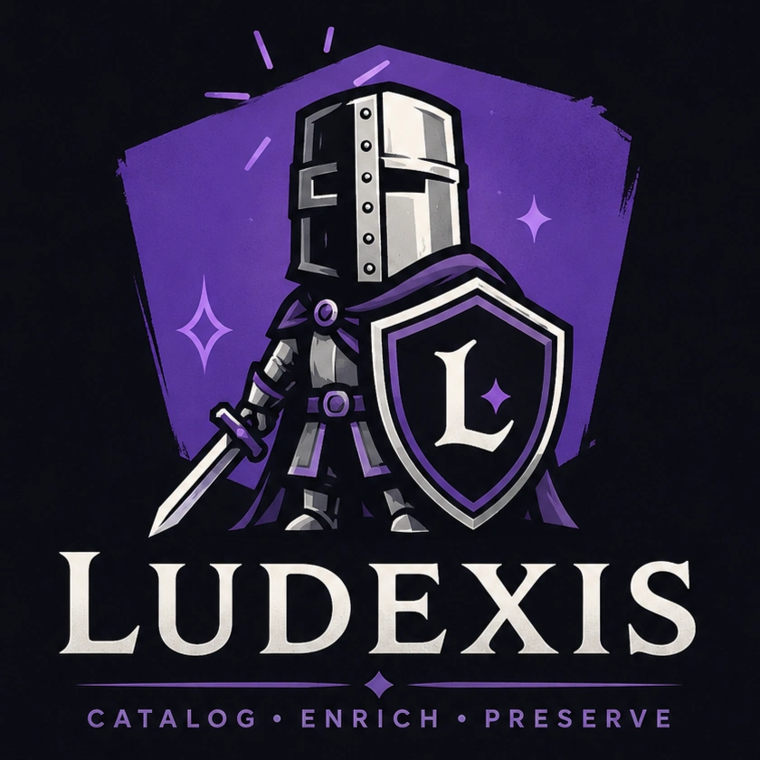
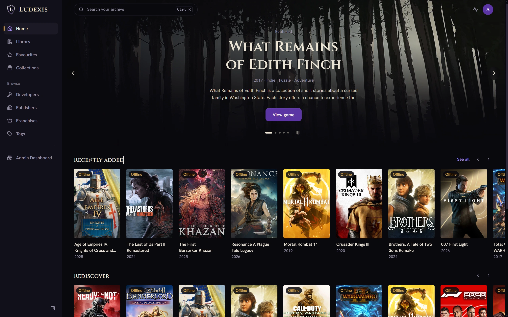
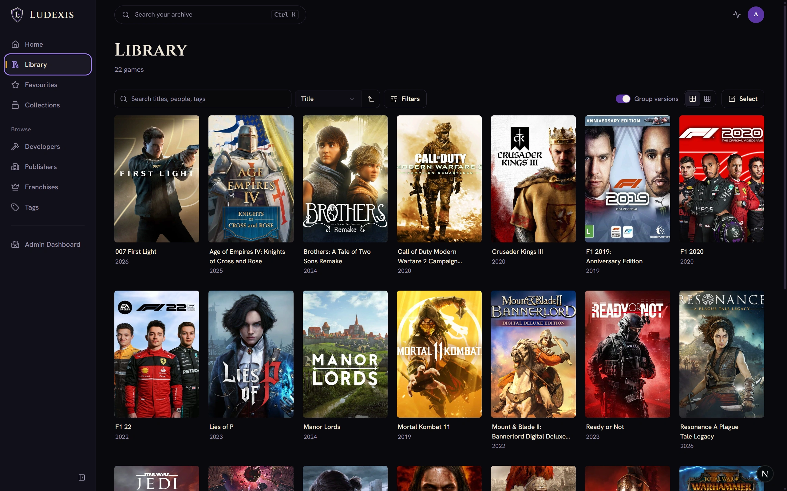
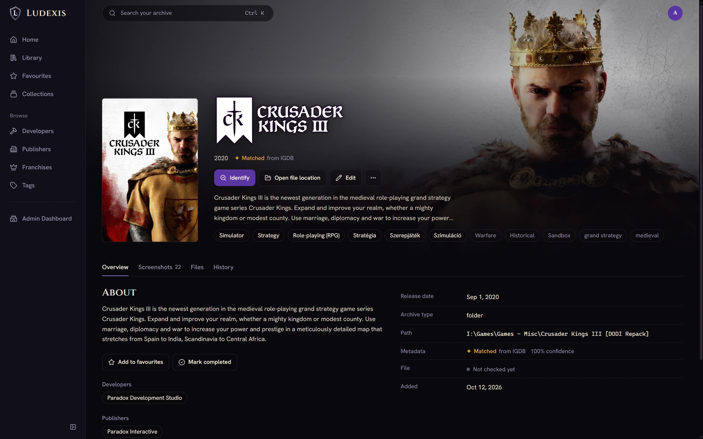
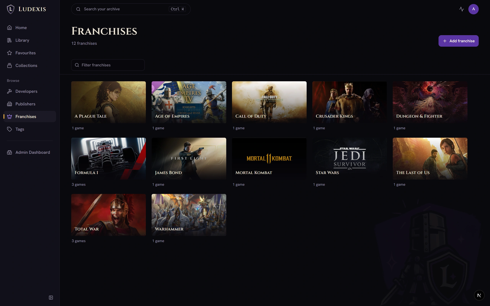

<p align="center">
  
</p>

<p align="center">
  <strong>A self-hosted catalogue for your game archives.</strong><br>
  Point it at your drives and get a searchable library with metadata, artwork and versions, without installing a single game.
</p>

<p align="center">
  <a href="#features">Features</a> •
  <a href="#screenshots">Screenshots</a> •
  <a href="#quick-start">Quick Start</a> •
  <a href="#development">Development</a> •
  <a href="#documentation">Documentation</a>
</p>

<p align="center">
  
  
  
  
  
  
  
</p>

<p align="center">
  
</p>

Game launchers expect installed games. Collections of archives, installers, visual novels and backups spread over several drives get no help from them. Ludexis catalogues the files themselves: it scans your libraries, recognises each game, fetches its details and artwork, groups versions together, and serves it all as a browsable web app for you and the people you share it with.

## Features

- **Library scanning**: full and incremental scans of folders and archives (`.zip`, `.rar`, `.7z`, `.iso`, `.exe` and unpacked game folders), on a schedule or on demand. Drives that are unplugged are marked offline and keep their entries.
- **Automatic metadata**: matches each game against VNDB, IGDB and Steam, and fills the gaps of one source from the others. Extra providers can be loaded from a folder.
- **Identify by hand**: search every source for a game that was missed or matched wrongly. Fixing one file leaves its other versions alone, unless you choose to change them all.
- **Versions and episodes**: files of the same game, under different names, versions or episodes, appear as one card with a Versions tab.
- **Artwork**: covers, banners, logos and screenshots are downloaded and stored locally. Covers are cropped to fit the card and kept still, even when the source is animated.
- **Organisation**: collections, franchises, developers, publishers, genres and tags, plus favourites and a completed mark for every user.
- **Accounts and access**: roles and permissions, with per-user library access. Restricted games, and any game you hide from its page, are shown only to accounts allowed them.
- **Background jobs**: scans, metadata refresh and artwork validation run in workers, with progress, history and schedules in the admin dashboard.
- **Monitoring**: optional Prometheus, Grafana and Node Exporter profile.

## Screenshots

<table>
  <tr>
    <td width="50%"><p align="center"><sub>Library: filters, sorting and grouped versions</sub></p></td>
    <td width="50%"><p align="center"><sub>Game page: details, screenshots, versions, files and history</sub></p></td>
  </tr>
  <tr>
    <td width="50%"><p align="center"><sub>Franchises</sub></p></td>
    <td width="50%"><p align="center"><sub>Home: featured games, recently added and rediscover</sub></p></td>
  </tr>
</table>

## Quick Start

Ludexis runs as one Docker Compose stack: the web app, API, worker, scheduler, PostgreSQL, Redis and a small proxy that serves everything on one port.

**Requirements:** Docker Engine 24+ with Compose, 2 GB RAM (4 GB for large libraries), and a folder of games.

```bash
curl -O https://raw.githubusercontent.com/InvictusRex/Ludexis/main/docker-compose.yml
curl -O https://raw.githubusercontent.com/InvictusRex/Ludexis/main/.env.example
mkdir deploy && curl -o deploy/Caddyfile https://raw.githubusercontent.com/InvictusRex/Ludexis/main/deploy/Caddyfile
cp .env.example .env
```

Set at least these in `.env`:

```env
GAMES_PATH=/mnt/games    # your games folder, mounted read-only at /games
TZ=Europe/Berlin         # scheduled tasks run in this time zone
POSTGRES_PASSWORD=change-me
```

Then start it:

```bash
docker compose up -d
```

Open `http://<host>:8420` and sign in as `admin` / `admin`. The setup screen asks for a new password, adds `/games` as the first library, optionally stores IGDB credentials, and starts the first scan.

<details>
<summary><strong>Default account, lost passwords and the JWT secret</strong></summary>

To start with other credentials, set `DEFAULT_ADMIN_USERNAME` and `DEFAULT_ADMIN_PASSWORD` in `.env` before the first start. Until the default password is changed, the API refuses every other request for that account.

Locked out? `docker compose exec backend python -m scripts.reset_password <username>` restores the default password and asks for a new one at the next sign-in.

The JWT signing secret is generated on first start and kept in the `ludexis_data` volume. Set `JWT_SECRET_KEY` only if you want to manage it yourself.
</details>

### Metadata sources

| Source | Key needed | Good for |
| ------ | ---------- | -------- |
| VNDB   | No | Visual novels and Ren'Py games |
| IGDB   | Twitch client ID and secret ([dev.twitch.tv](https://dev.twitch.tv/console)) | Most commercial games |
| Steam  | No | Steam releases, descriptions and screenshots |

Order and enable them under **Admin > Settings**. The first source with a confident match supplies the metadata; the others add what it lacks when they clearly have the same game. Sources that can hold restricted content are only used for accounts allowed it.

When a match is missing or wrong, open the game and choose **Identify**. To hide a game from accounts without restricted access, use **⋯ > Hide game** on its page.

### Updating

```bash
docker compose pull && docker compose up -d
```

Database migrations run automatically when the backend starts.

<details>
<summary><strong>HTTPS</strong></summary>

On a home network `http://<host>:8420` is fine. Before exposing Ludexis to the internet, point a domain at the host and set:

```env
LUDEXIS_DOMAIN=games.example.com
LUDEXIS_PORT=80
LUDEXIS_HTTPS_PORT=443
```

After `docker compose up -d`, Caddy obtains and renews a certificate, redirects HTTP to HTTPS, and session cookies are marked `Secure`. Certificates are kept in the `caddy_data` volume.
</details>

<details>
<summary><strong>Backups</strong></summary>

What needs backing up is the database and the `ludexis_data` volume (artwork and the JWT secret). From the folder with `docker-compose.yml`:

```bash
docker compose exec -T db pg_dump -U ludexis -Fc ludexis > ludexis-db.dump
docker compose run --rm --no-deps -v "$PWD:/backup" --entrypoint tar backend czf /backup/ludexis-data.tgz -C /data .
```

To restore into a fresh stack:

```bash
docker compose up -d db
docker compose exec -T db pg_restore -U ludexis -d ludexis --clean --if-exists < ludexis-db.dump
docker compose run --rm --no-deps -v "$PWD:/backup" --entrypoint tar backend xzf /backup/ludexis-data.tgz -C /data
docker compose up -d
```

Ludexis never modifies your game files, so they need no backup from it.
</details>

<details>
<summary><strong>Monitoring</strong></summary>

The backend exposes Prometheus metrics at `/api/metrics` inside the stack; the proxy does not serve them publicly. To collect and chart them:

```bash
docker compose --profile monitoring up -d
```

This adds Prometheus, Node Exporter and Grafana on port 3000 (`GRAFANA_PORT`). Grafana asks you to replace its `admin`/`admin` sign-in; then add a Prometheus data source at `http://prometheus:9090`.
</details>

## Development

PostgreSQL and Redis run in Docker. The API, worker, scheduler and the Next.js dev server run on the host, with hot reload.

```bash
git clone https://github.com/InvictusRex/Ludexis.git
cd Ludexis
docker compose -f docker-compose.dev.yml up -d   # PostgreSQL on 5432, Redis on 6379 (localhost only)
```

**Backend**

```bash
cd backend
python -m venv .venv
source .venv/bin/activate            # Windows: .venv\Scripts\activate
pip install -r ../requirements-dev.txt
cp .env.example .env                 # add TWITCH_CLIENT_ID / TWITCH_CLIENT_SECRET for IGDB
alembic upgrade head
uvicorn main:app --reload            # http://localhost:8000, API docs at /docs
```

In two more terminals:

```bash
celery -A app.tasks.celery_app worker --loglevel=info   # add --pool=solo on Windows
celery -A app.tasks.celery_app beat --loglevel=info     # scheduled tasks
```

**Frontend**

```bash
cd frontend
cp .env.example .env.local
npm ci
npm run dev                          # http://localhost:3000
```

**Tests**

```bash
cd backend && pytest
cd frontend && npx vitest run
```

## Documentation

| Document | What it covers |
| -------- | -------------- |
| [Project Overview](docs/architecture/Project-Overview.md) | Why Ludexis exists, its feature set and how the pieces fit together |
| [Architecture](docs/architecture/) | Backend architecture, data model, ERD and processing pipeline |
| [API Guide](docs/api/API-Guide.md) | REST API reference |
| [Deployment](docs/deployment/Deployment.md) | Deployment and operations |
| [Integrations](docs/integrations/) | cURL, Python and JavaScript examples |
| [Backlogs](docs/backlogs/) | Roadmap and planned work |
| [Release notes](docs/release/RELEASE_NOTES.md) | Changes per release |

## License

Ludexis is released under the [MIT License](LICENSE).

## Acknowledgements

Built on FastAPI, SQLAlchemy, Next.js, PostgreSQL, Redis, Celery, Caddy, Prometheus and Grafana. Game data comes from VNDB, IGDB and Steam.
