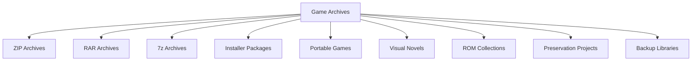
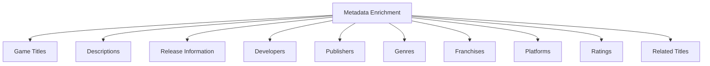
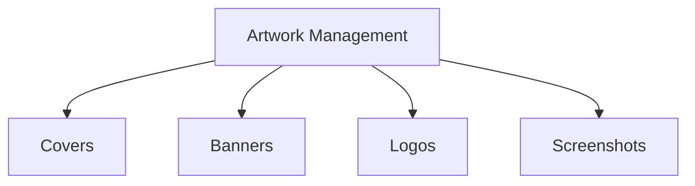
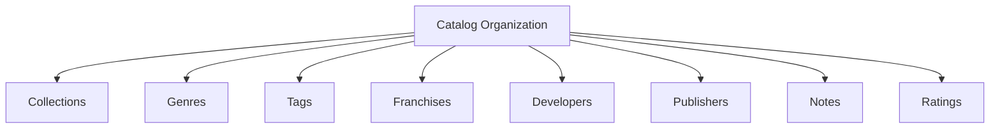
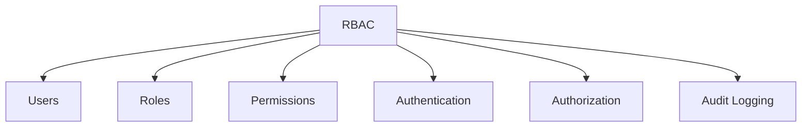
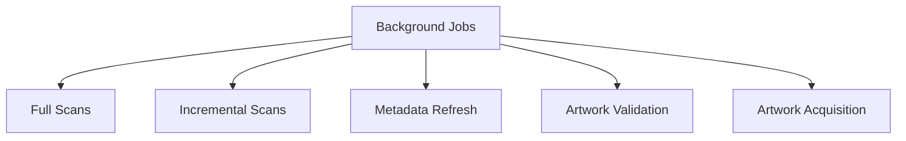
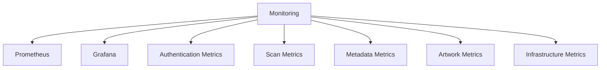
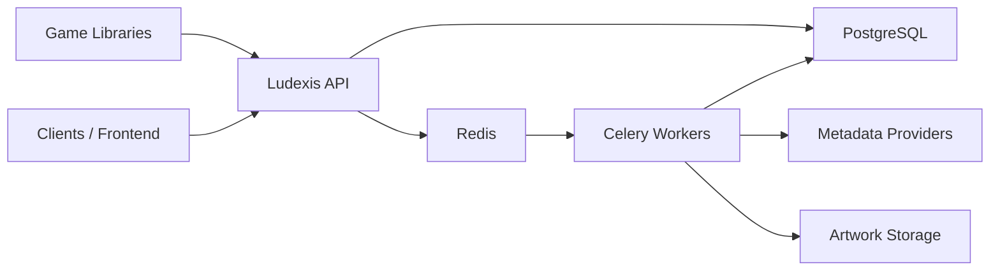
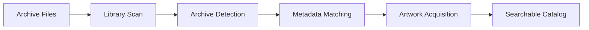

# Ludexis Project Overview

The ideas behind Ludexis: the problem it solves, what it does, and how its parts fit together. For installation and day-to-day use see the [README](../../README.md); for the internals see [Architecture Overview](Architecture-Overview.md), [Backend Architecture](Backend-Architecture.md), [Data Model](Data-Model.md) and [Processing Pipeline](Processing-Pipeline.md).

---

## Why Ludexis?

Ludexis began as a response to a problem that many digital preservation enthusiasts, visual novel collectors, retro gaming archivists, and self-hosting users eventually encounter: there are plenty of game launchers, but very few tools designed specifically for managing large game archives.

Most existing platforms focus on launching installed games. Their catalogs are typically built around executable discovery, launcher integration, storefront synchronization, or installation management. This works well for modern Steam libraries but becomes increasingly limiting when dealing with preservation-oriented collections.

Many archives consist of compressed releases, installer packages, visual novels, portable games, ROM collections, abandonware archives, backup media, and other content that may never be installed or directly executable. In these scenarios, the archive itself is often the asset being managed rather than a runnable game installation.

Ludexis approaches the problem from a different perspective. Instead of asking "How do I launch this game?", it asks "How do I catalog, organize, enrich, preserve, and manage this archive?"

A single Ludexis deployment can catalog content such as:

Rather than depending on launchers, executables, storefront APIs, or installed applications, Ludexis focuses on metadata management, artwork acquisition, catalog organization, archive preservation, and long-term collection maintenance.

The result is a platform designed specifically for users who maintain game archives rather than game installations.

---

## Overview

Ludexis is a self-hosted game archive management platform designed for users who maintain collections of installers, archived game releases, visual novels, preservation projects, backups, and multi-drive game libraries.

As collections grow across hard drives, NAS systems, external storage devices, and backup archives, maintaining accurate records becomes increasingly difficult. Information such as release versions, publishers, developers, storage locations, screenshots, artwork, and related titles often becomes fragmented or lost entirely.

Ludexis solves this problem by transforming raw archive files into a searchable and enriched catalog. Through automated scanning, metadata matching, artwork acquisition, collections, tagging, and background processing, Ludexis provides a centralized platform for managing and preserving game archives.

Unlike traditional game launchers, Ludexis focuses on cataloging, organization, metadata enrichment, and long-term archival management rather than game launching.

---

## Key Features

### Automated Library Discovery & Scanning

Ludexis continuously catalogs game archives stored across local drives, external storage devices, NAS systems, and archival repositories. Libraries can be configured as scan targets, allowing the platform to automatically discover supported archives and game folders without requiring manual entry.

Both full and incremental scanning modes are supported. Full scans rebuild catalog information across an entire library, while incremental scans process only newly added or modified content, significantly reducing maintenance overhead for large collections.

Discovered entries are normalized and stored in a structured catalog, enabling consistent metadata enrichment and organization regardless of the original archive source.

### Metadata Aggregation & Enrichment

Ludexis automatically enriches archive entries from VNDB, IGDB and Steam through a provider-agnostic architecture that allows additional metadata sources to be integrated over time. A match on one source is completed with whatever the others know about the same game, and any entry can be identified by hand from a search across all of them.

Metadata enrichment transforms raw archive files into richly cataloged entries by retrieving official game information and associating it with discovered archives.

This allows raw archive files to be transformed into rich, searchable catalog entries without extensive manual curation.

### Artwork Acquisition & Management

Ludexis supports comprehensive artwork management for archive entries. Artwork assets are stored locally to ensure long-term availability independent of third-party services.

Artwork may be uploaded manually or automatically acquired through the metadata enrichment pipeline. Validation and maintenance operations ensure artwork remains synchronized with associated archive entries while avoiding duplicate assets and broken references.

### Advanced Catalog Organization

Beyond simple file storage, Ludexis provides multiple organizational layers for managing large collections.

These relationships allow users to build curated collections and navigate large archives through meaningful metadata rather than filesystem structure alone.

### Archive Preservation & Verification

Ludexis is designed with preservation-oriented workflows in mind. Archive records maintain filesystem metadata, verification status, storage information, and catalog history to support long-term archival management.

Planned integrity workflows include archive verification, corruption detection, duplicate identification, and preservation auditing to assist users maintaining large game collections over extended periods.

### User Management & Role-Based Access Control

The platform includes a complete authentication and authorization system built around Role-Based Access Control (RBAC).

This enables Ludexis to scale from single-user deployments to shared archival environments.

### Background Processing & Job Management

Long-running operations execute asynchronously through Celery workers, ensuring the API remains responsive regardless of collection size.

A centralized job system provides visibility into task progress, execution history, completion status, and failure reporting.

### Monitoring & Observability

Ludexis includes built-in operational monitoring through Prometheus and Grafana.

Prometheus, Grafana and Node Exporter ship as an optional profile of the Compose stack, so monitoring costs nothing until it is switched on.

---

## Architecture Overview

Ludexis follows a service-oriented architecture designed around clear separation of responsibilities, asynchronous processing, and persistent metadata storage.

The FastAPI backend serves as the central orchestration layer, coordinating authentication, catalog management, metadata operations, search functionality, and administrative workflows. PostgreSQL stores all persistent data, Redis provides task queue infrastructure, and Celery workers execute long-running background operations independently from user-facing requests.

---

## How Ludexis Works

The processing pipeline transforms raw archive files into fully cataloged archive entries.

When a library scan is initiated, Ludexis discovers archive files and folders, extracts filesystem metadata, creates catalog entries, enriches them using metadata providers, downloads available artwork, and stores the resulting information in a searchable database.

This workflow allows large collections to be cataloged with minimal manual effort while still supporting manual curation when required.
